# M3 · 匹配 UVC 源码、原版构建与实际回退

2026-11-16 板端验证通过：未修改的 UVC 源码编译、临时加载、采集、卸载及恢复
系统原模块均已执行。它建立 M4 的构建与回退基线，尚不是新增驱动功能。
M3 的模型数值回归另行验收，阶段总状态见 [progress](progress.md)。

## 来源和构建身份

- 目标：L4T R36.4.3，`5.15.148-tegra`；官方
  [发布页](https://developer.nvidia.com/embedded/jetson-linux-r3643) 与
  [内核定制说明](https://docs.nvidia.com/jetson/archives/r36.4.3/DeveloperGuide/SD/Kernel/KernelCustomization.html)。
- 下载 `public_sources.tbz2`，SHA256
  `2c177804679e3ed650dabec6fa958388579896f170570c6171a1b6c386669216`。
  嵌套 `Linux_for_Tegra/source/kernel_src.tbz2` SHA256
  `0c314c5174d07149194e0a5a50d0f14a4ee5a4fe2cd1f382b471624cc1aa5184`。
  这是本机冻结哈希，未冒称厂商发布的校验值。
- 保留完整 UVC 13 个原始文件及 GPL 声明；未用其他 Linux 5.15 源码替代。
- 使用当前 `/lib/modules/$(uname -r)/build` 指向的实际 headers、`.config` 与
  `Module.symvers`。这些 headers 没有 UVC C 源码，源码单独来自匹配发布包。
- 原内核用 Bootlin GCC 11.3 构建，本次原生 GCC 11.4。vermagic、srcversion 相同，
  155 个导入符号 CRC 全部匹配；构建前后 headers 配置与符号表哈希不变。

## 实机切换

独立入口：`fetch_kernel_sources.py` 下载/冻结，`build_uvc_module.py` 只构建，
`verify_uvc_baseline.py --mode prepare` 备份并输出计划，`--mode verify` 实际验证。
参数及精确命令保存在原始证据的 plan/build record 中。

| 实际加载模块 | GNU Build ID | 5 秒消费帧 | sequence 缺口 |
|---|---|---:|---:|
| 系统原模块 | `4f3253a8a815a048b37be4908a51db4ef5b66053` | 151 | 0 |
| 自编译未改模块 | `df05b47372a7b88f0beb19cca77aa2508a682a90` | 150 | 0 |
| 回退后的系统模块 | `4f3253a8a815a048b37be4908a51db4ef5b66053` | 151 | 0 |

三段监督进程均正常退出，设备占用者清空。模块身份来自
`/sys/module/uvcvideo/notes/.note.gnu.build-id`，不能用默认 `modinfo uvcvideo`
代替运行模块核验，因为后者读取磁盘上的系统模块。

没有覆盖 `/lib/modules`、执行 depmod、修改启动项或改变签名策略。
当前 `sig_enforce=N`；自编译模块未签名，加载后 taint 从 4096 变为 12288，
回退不清除此标志。原模块备份和可执行 rollback.sh 保留；未为清 taint 擅自重启。
这些短窗只证明基本行为与实际回退，不是性能等价或长期稳定结论。

## 本目标的调用链与所有权

以下名称来自冻结的 `drivers/media/usb/uvc` 源码。

```mermaid
flowchart LR
  A[open / uvc_v4l2_open] --> B[REQBUFS / uvc_request_buffers / vb2_reqbufs]
  B --> C[mmap / uvc_queue_mmap / vb2_mmap]
  C --> D[QBUF / vb2_qbuf / uvc_buffer_prepare + uvc_buffer_queue]
  D --> E[STREAMON / vb2_streamon / uvc_start_streaming]
  E --> F[uvc_video_start_streaming / submit URBs]
  F --> G[uvc_video_complete / decode isoc or bulk]
  G --> H[uvc_video_next_buffers / remove irqqueue]
  H --> I[kref last release / uvc_queue_buffer_complete]
  I --> J[vb2_buffer_done / wake poll]
  J --> K[DQBUF / vb2_dqbuf / uvc_buffer_finish]
  K --> D
```

- `queue->mutex` 串行化 vb2 用户态队列操作，`stream->mutex` 保护格式与硬件协商；
  `queue->irqlock` 保护 IRQ 队列及断连标志，不可从 USB 回调新增睡眠操作。
- QBUF 为缓冲初始化 kref 并加入 IRQ 队列。帧可能跨多个包/URB；`uvc_queue_next_buffer`
  从链表移走它并释放一份引用，异步复制的最后一个引用归还后才交给 vb2。
  因而“看到 EOF”不等于“用户态已可 DQBUF”。
- 正常 `uvc_queue_buffer_complete` 将有效长度写入 vb2，再 `vb2_buffer_done`。
  DROP_CORRUPTED 分支可能内部重排错误帧，用户态没有对应 DQBUF；这正是拟新增追踪的缺口。
- stream sequence 在解码中按 FID 推进，不能拿 URB 数当帧数；STREAMON 重置 sequence。
  不同用户态 generation 必须分开关联，并处理 uint32 回绕。
- STREAMOFF：vb2 → `uvc_stop_streaming` → 停止传输、取消 URB、处理异步工作，再在
  irqlock 下归还排队缓冲。disconnect：`uvc_disconnect` → `uvc_unregister_video`，
  队列取消与 DISCONNECTED 标志防止 QBUF/断连竞态；不能在锁外简单判断后继续排队。
- 队列声明驱动时间戳 MONOTONIC/SOE，`uvc_buffer_finish` 会做 UVC 时钟更新。
  它不同于拟新增的 `ktime_get_ns()` 完成时刻；后者才与用户态 steady/monotonic DQ 时刻比较。

M4 先记录现有 V4L2/vb2 事件的覆盖，再增加一帧一事件的 UVC 完成/内部丢弃记录，
不在每个 URB 或 USB 包打印日志。问题分析统一维护
[EV-KERNEL-001](debugging_journal.md#ev-kernel-001--2026-11-16--匹配源码构建与运行模块身份)。
